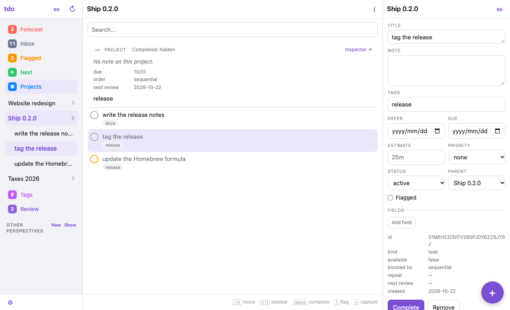
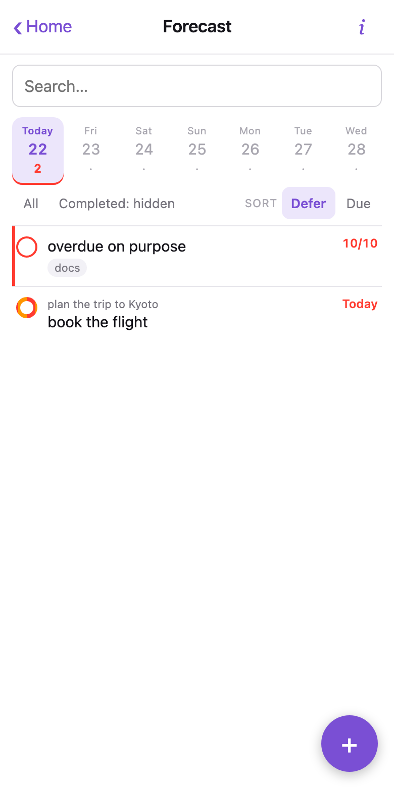
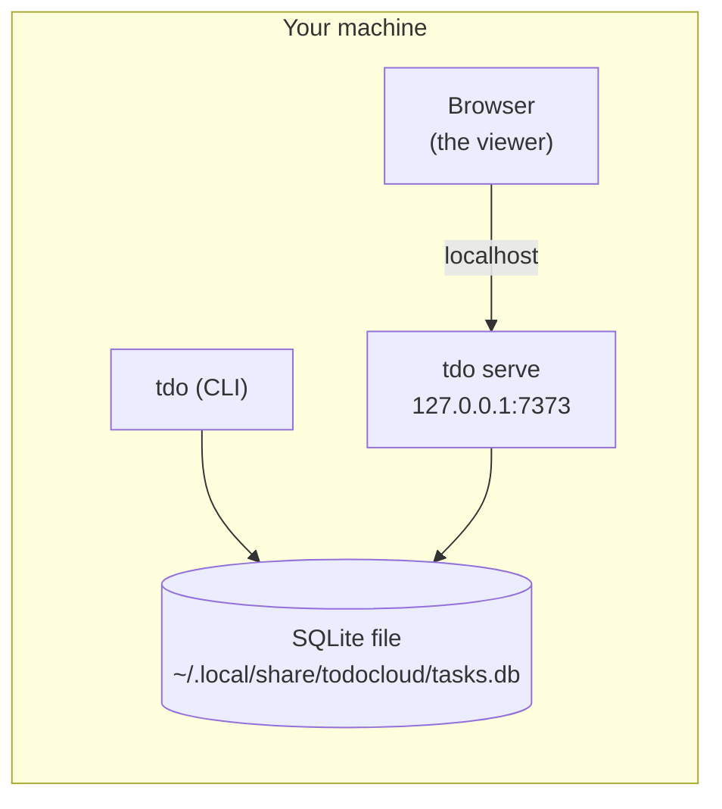
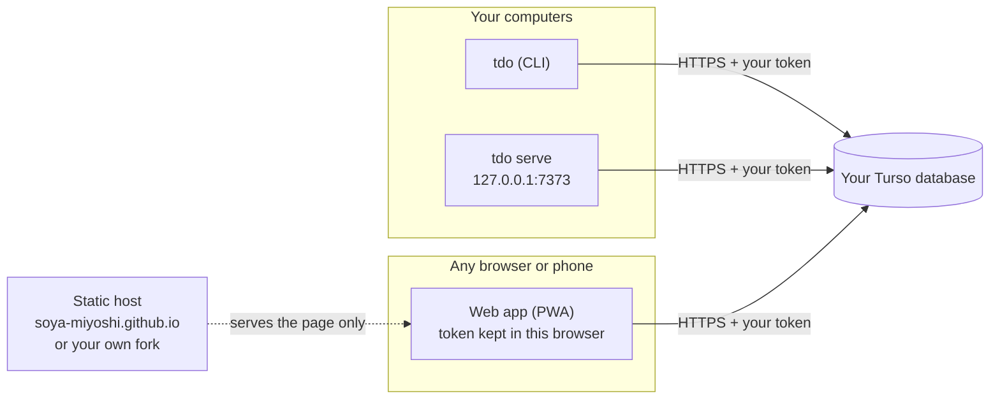
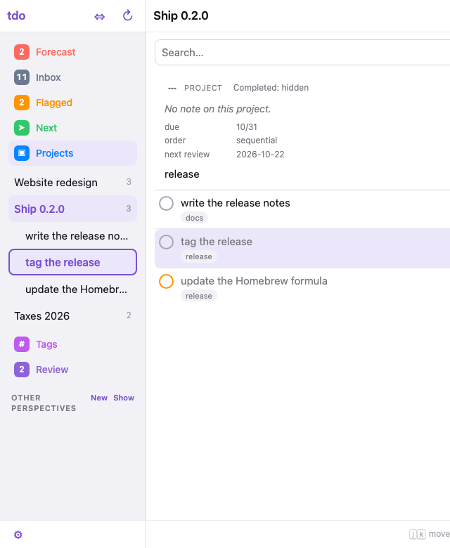

# todocloud (`tdo`)

A todo list in a database **you** own — from the terminal, a browser, or your phone.

<table>
  <tr>
    <td align="center"><br><sub>In a browser: <code>tdo serve</code> or the web app</sub></td>
    <td align="center"><br><sub>On a phone: the web app (PWA)</sub></td>
  </tr>
</table>

```console
$ tdo add "Pay the invoice" --due 2026-11-01 --tag admin
$ tdo forecast --day today
Today — 2026-10-22
#  S   K  DUE         TITLE               TAGS
1         2026-10-10  overdue on purpose  docs
2   *     2026-10-22  book the flight
```

There is no todocloud server and no account to sign up for.
Every client talks straight to *your* database with *your* credentials, and
your tasks go there and nowhere else.

## How the pieces connect

### Local SQLite only

Nothing leaves your machine, and there is nothing to sign up for or host.



### With Turso (one list on every device)



- **`tdo` (CLI)** is one binary. It reads and writes either a local SQLite
  file or your Turso database.
- **`tdo serve`** is the same viewer as the web app, served from your own
  machine on `127.0.0.1`.
- **The web app** is a static page. The host that serves it never sees your
  data or your token: the page runs in your browser and calls Turso directly.
  It cannot reach a SQLite file on your machine, so it needs Turso.
- **Turso** is what lets all of them see one list.

## Install

### The CLI

```sh
brew install soya-miyoshi/tap/tdo

# or, from a clone, with Node and Bun (see mise.toml):
make install
```

`tdo` is one file with no runtime to install: the executable is compiled with
`bun build --compile`, so it carries its own JavaScript engine. Node and Bun
are needed to *build* it, not to run it.

Archives are published for Linux and macOS on both Intel and Apple Silicon /
arm64, and for Windows on amd64. Homebrew covers macOS and Linux; everything
else downloads an archive.

#### From an archive

Download the one for your platform from the
[releases page](https://github.com/soya-miyoshi/todocloud/releases) —
`tdo_<version>_<os>_<arch>.tar.gz`, or `.zip` for Windows — and check it
against the `SHA256SUMS` file published beside it before unpacking:

```sh
sha256sum --check --ignore-missing SHA256SUMS   # shasum -a 256 -c on macOS
tar -xzf tdo_<version>_<os>_<arch>.tar.gz
mv tdo ~/.local/bin/                            # anywhere on your PATH
```

Each archive holds one static binary with nothing to install alongside it, so
installing is moving that file somewhere on your `PATH`, and uninstalling is
deleting it.

**On Windows** there is no package manager route: Homebrew does not cover
Windows, so download `tdo_<version>_windows_amd64.zip` from the releases page,
check it against `SHA256SUMS` the same way, and put `tdo.exe` wherever your
`PATH` can find it. Windows on arm64 has no archive yet.

The tap carries the latest `vX.Y.Z` tag. A prerelease (`-rc.1` and the like)
is on the releases page only, deliberately: `brew upgrade` should not move
anyone onto one.

### The web app

It is a progressive web app with no backend, so there is nothing to run.
Either:

1. **Use the hosted copy.** Open <https://soya-miyoshi.github.io>, enter your
   Turso database URL and token on the connect screen, and (on a phone) use the
   browser's *Add to Home Screen*. The page is only code: your URL and token
   are stored in that browser and are sent to your database, never to the host.
2. **Host your own.** Fork this repository and publish `packages/pwa` as a
   static site at the *root* of a domain, for example your own
   `<you>.github.io` repository (the app's paths are root-absolute, so it
   cannot live under `/todocloud/`).
   - By hand: `npm ci && npm run build --workspace @todocloud/pwa`, then copy
     `packages/pwa/dist/` to any static host.
   - With the workflow: `.github/workflows/pwa.yml` deploys on every push to
     `main`. Point its `git clone` target at your own `<you>.github.io`
     repository, add a write deploy key there and its private half to your
     fork as the `PWA_PAGES_DEPLOY_KEY` secret.

Either way you need a Turso database, because that is what the page and the CLI
share; see [Providers](#providers).

## First run

Local SQLite needs no credential at all:

```sh
tdo init                           # creates ~/.local/share/todocloud/tasks.db
tdo add "Pay the invoice" --due 2026-11-01
tdo ls
tdo serve                          # the viewer, at http://127.0.0.1:7373/
```

`tdo init` is the one command that creates the database; no other command
creates the file or the directory holding it. Point `tdo` at the wrong path and
you get an error telling you to run `tdo init` — not a second, empty task list.

## What it does

The model is GTD as OmniFocus implements it, not a flat checklist — because the
useful question is not "what do I have to do" but "what can I do right now".

- **One tree:** folders hold projects, projects hold tasks, tasks can hold
  tasks. The inbox is simply a task with no parent.
- **Four statuses:** `active`, `on_hold`, `done`, `dropped`.
- **`tdo ls` shows what is available now**, hiding what is deferred, on hold or
  queued behind an earlier step; `tdo ls --blocked` says why.
- **`tdo forecast`** is the dated work, and the page the viewer opens on.
- Repeats, tags, saved perspectives, review dates and your own fields.

The commands, the rules behind them and the settings are in
[docs/usage.md](docs/usage.md).

## A browser viewer

`tdo serve` serves a small read-write viewer for your list on a local port:
perspectives on the left, the items in the middle, one item's details on the
right.

```sh
tdo serve                  # http://127.0.0.1:7373/
tdo serve --port 8080      # somewhere else
tdo serve --port 0         # any free port; it prints the one it got
```

It reads and writes through the same code the commands do, so completing
something in the browser is `tdo done`, repeat and all.

**The sidebar is the whole map, and you can drive it from the keyboard.**
Click *Projects* and every open project is listed directly under it; click a
project to open it, and its tasks unfold beneath it at every depth, so you
can see the shape of a project without leaving the list you are on. Folders
are a CLI concept and are not shown there. *Tags* works the same way and
starts shut. Both lists remember whether they were open, and the sidebar's
width (`small` to `wide`) is the `⇔` button at its top or *Settings*.



| Key | Does |
|---|---|
| `h` | move the keys to the sidebar, on the row for what is open |
| `j` `k` | move down and up (`↓` `↑` too); the inspector and the list follow the row you are on |
| `l` | open the row; on an open project or tile, step into it; on a task, show it in the inspector with the cursor in its title |
| `h` (in the sidebar) | fold an open project or tile; on a task, go back to its project |
| `Enter` | open the row and put the cursor in the inspector's title, so `Tab` walks the fields |
| `Esc`, or `jj` typed quickly in a field | leave a field; from the inspector's fields, `jj` also lands on the item's project in the sidebar |

Outside the sidebar `j` `k` move through the list, `space` completes,
`f` flags, `n` captures and `/` searches.

On a phone it opens on the Forecast and shows one pane at a time; for
installing it to a home screen, the write token, `--addr`, Tailscale and the
rest, see [docs/viewer.md](docs/viewer.md).

## Providers

| Provider | Credential | Can the credential be scoped to just this database? | State |
|---|---|---|---|
| Local SQLite | none — a file path | n/a | works |
| Turso / libSQL | database URL + token | **Yes, per database.** Recommended for narrow credentials. | works |
| Cloudflare D1 | account ID + API token | **No — the token covers every D1 database in the account.** See [SECURITY.md](SECURITY.md) | later |

A Firestore provider was built and then removed; it is not coming back. The
reasoning is in [`docs/providers.md`](docs/providers.md) and in PLAN.md §2.

Turso is the provider to choose if you want the narrowest possible credential,
because its tokens are issued per database — and `tdo login` mints one for you
with the `turso` CLI, so nothing is ever pasted. See
[`docs/providers.md`](docs/providers.md) for the setup of each.

## More

- [docs/usage.md](docs/usage.md) — the model, the commands, choosing a store,
  upgrading the schema, your own fields, configuration.
- [docs/providers.md](docs/providers.md) — setting up each provider.
- [SECURITY.md](SECURITY.md) — how credentials are held and scoped.
- [Use from an AI agent or a script](docs/agents.md) — every command takes
  `--json`; start at [`AGENTS.md`](AGENTS.md).
- [CONTRIBUTING.md](CONTRIBUTING.md) and [CLAUDE.md](CLAUDE.md) — building,
  testing and releasing.

## License

MIT
